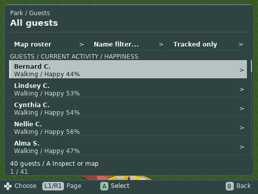
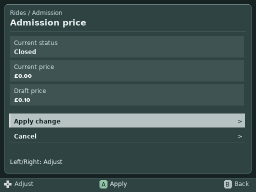
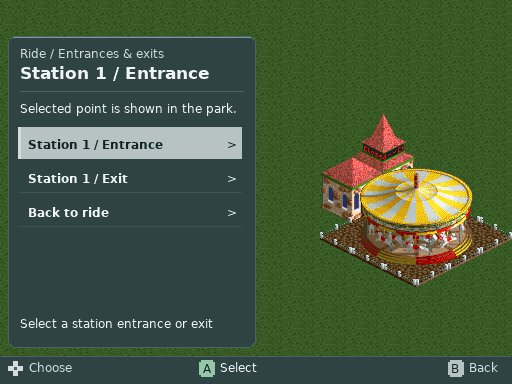
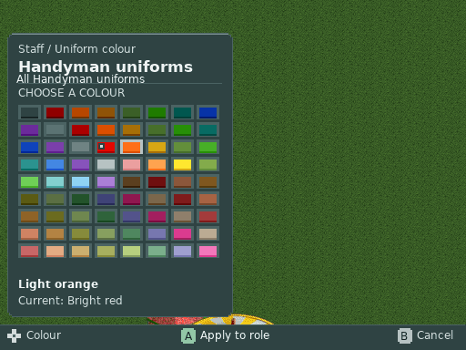
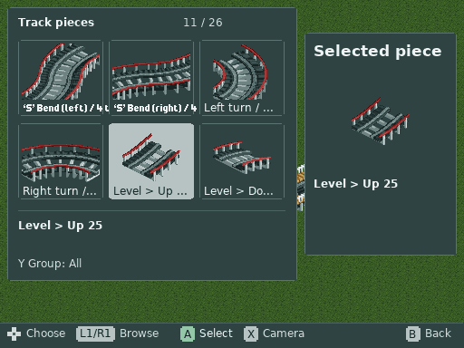

# Brick menu feel: first implementation pass

Continues canonical `2e819797f21379db2213f9cbef3bacd6207a53a7` and the
[menu audit](BRICK-NATIVE-MENU-AUDIT.md). This is a bounded first pass, not
completion of BF01–BF10 or the full RC4 milestone. The hardware Line/Fill defect
remains deferred and unresolved at the user's request.

## Navigation

Management lists, generic secondary menus and the existing visual object catalog
now use a clipped pixel viewport instead of replacing a page of rows. Focus
responds to each input immediately. Near the lower edge the rows ease upward;
headings, toolbars, status and the single-row controller footer remain fixed.
A short 45 ms easing constant avoids input lag. Large jumps reveal focus
immediately, and held repeats cannot push the selected row out of view.

Scroll positions belong to the menu window and individual page/tab. They are
presentation state, never saved simulation state. List ends clamp instead of
wrapping. Existing L1/R1 fast browsing remains available. Catalogs retain their
three-column layout, native previews and full selected-item name. Their detail
panel keeps a stable height through the last row.

Guest/staff roster preparation now includes neighbouring rows around focus. The
old page-only preparation would otherwise leave blank text during animation.
This remains bounded, rather than formatting every guest's activity in a large
park on every frame.

## Shorter everyday edits

Ride admission and ordinary numeric settings use Left/Right to adjust, then
**Apply change** or B to discard. Park admission uses **Apply price**. These
reuse the existing native query/execution paths, busy guards, stale-state
validation and callback lifetime protection. No balance or simulation rules
are replaced. Vehicle configuration retains its consequence review; loans,
demolition, dismissal, construction, overwrite/discard and other protected
operations keep their existing deliberate reviews. Native failures remain
visible. Confirmations name the actual operation.

## Show the selected thing

Entrance/exit management now centres and highlights the exact native access
point in the park beside its controller panel. Selecting the entrance or exit
updates that view; Move, Remove and path/queue connection retain the native
handlers and validation. Rendering restores the temporary map-selection flags,
type and bounds. It does not create paths or change access geometry.

Uniform selection reuses the 72-colour palette grid. D-pad chooses a draft,
A applies through the native role-wide uniform action, and B discards it.
The panel explicitly states that every employee of the role is affected.
Entertainer costumes retain their existing separate functionality.

## Copy and density

The redundant generic ACTIONS heading is removed. Common workspace breadcrumbs,
news/history labels, costs and pickup wording use ordinary language. The pass
changes Pocket presentation strings, not the engine's native error messages.
The accepted slate-green palette, visual catalogs and simulation remain intact.

## Runtime evidence

These are native initialized-map/SDL component captures at 512×384, using the
engine viewport and production Pocket menu renderer with user-supplied original
sprites. They are not mockups or physical Brick photographs. GIF frames are
native captures; playback timing is illustrative, not a device performance test.

See the accompanying verification log for the exact test and build results.
`BrickFeelTests.cpp` checks direct native price mutation, B discard, external
price changes/stale rejection, cash invariants, temporary map-selection
restoration, neighbouring roster content, held-scroll bounds and native uniform
Apply/Cancel. Every captured frame checks the 28-pixel single-row footer.
`ListScrollTests.cpp` checks intermediate/settled offsets, focus visibility,
empty/shrunk lists, fast jumps and independent view state using an explicit clock.

## Still to do

- BF01/BF09: continue reachable copy/density cleanup, selected disabled-action
  explanations and low-frequency advanced details.
- BF02: ordinary name/toggle/appearance flows beyond this numeric editor pass.
- BF04: saved-design controls beside the native placement preview, compatible
  vehicle cards and contextual warnings. Existing warnings are preserved.
- BF05/BF06: larger map presentation and visual research catalog.
- BF07: costume thumbnails and patrol brush controls. Uniform grid is implemented.
- BF08: saved-park preview images, directory navigation and save-browser density.
- BF10: compact news/history detail layout. Existing native subject handoffs stay.
- All-menu device play, display/readability, held-input feel and performance on
  a real TrimUI Brick/NextUI. Desktop native fixtures cannot establish those.
