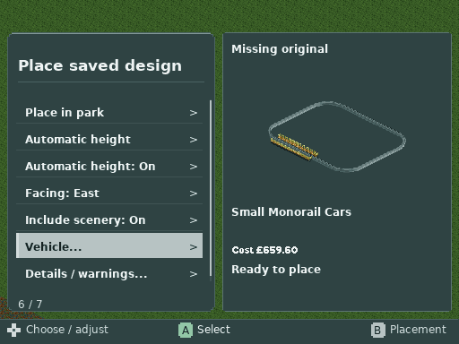
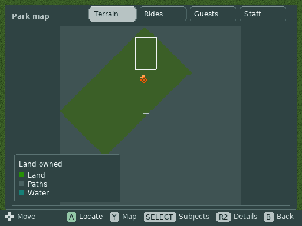
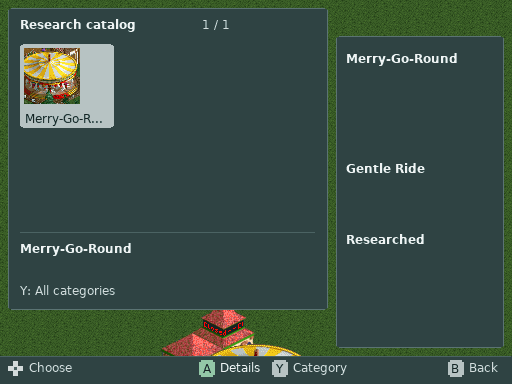
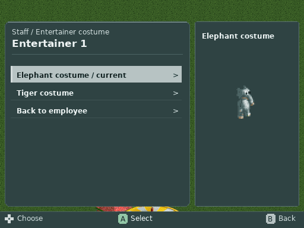
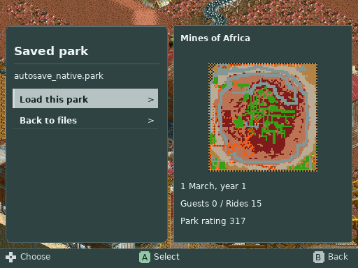
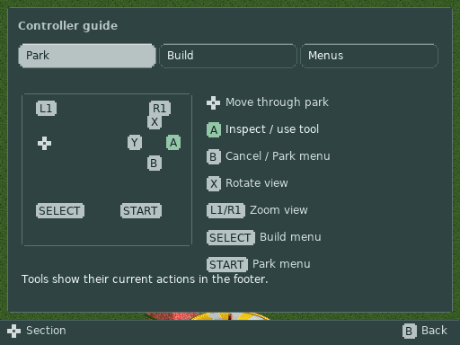

# Brick-native audit implementation

Continues published `c8c869a36457921969a1c39b1c14f8f684440b36` on
`handheld/modern-ui-paths`. All existing remote files and history are preserved.
Source checkpoints were published during implementation: `c880e84`, `e4315eb`,
`9ee82a4`, and `a1b463a`. This report describes the final reachable workflows.

## Delivered

| Audit | Current interaction |
|---|---|
| BF01 / BF09 | Player-facing research, history, awards, pickup and design labels; repeated Duties/Needs tutorials removed; actual game text and native failures retained. Scenery adjustment shows supported colour channels and explains objects without adjustable colours. |
| BF02 | Done applies ride/shop/staff/guest/sign names through existing guarded native actions. Tracking and harmless appearance changes apply directly. Secondary setting lists restore the selected item, without adding to existing tab/roster bookmarks. Numeric Apply/B discard and consequential vehicle, financial, demolition, dismissal, patrol-clear, overwrite and unsaved-exit reviews remain. |
| BF03 | Accepted spatial entrance/exit selection, native access actions and focus/temporary-selection restoration are preserved and regression checked. |
| BF04 | Saved-design workspace keeps the real four-orientation native preview beside direct height, automatic height, orientation and scenery controls. Compatible vehicles use native visual cards. Native query cost/readiness is shown only when available; missing targets ask for land. File inspection leads with the design and vehicle names; detailed IDs/compatibility remain in Details. Omitted scenery, changed vehicle limits, partial failures and overwrites retain warnings/protection. Export scenery uses readable names and highlights its actual origin in the park, restoring temporary map selection afterward. |
| BF05 | Map drawing area expands from 312×284 to 472×304. Compact mode tabs, visual swatches, ownership and selected subject replace the coordinate sidebar. R2 exposes coordinates, dimensions, rotation and filter details. Native projection, subjects, locate, rotation, zoom and caller return remain. |
| BF06 | Research reuses the three-column visual picker and native object renderer, with readable names/categories/states and full selected names. Y changes category. Construction is offered only for current, researched objects supported by the existing shop/flat/maze/track tools. Funding/priority drafts retain existing native costs and protection. |
| BF07 | Role/costume selection draws native peep sprites. The accepted role-wide uniform grid remains. Visible L2/R2 patrol shortcuts resize a square brush; rectangular width/height options remain discoverable. Hire wages, role restrictions, duty drafts and whole-patrol clearing safeguards remain. |
| BF08 | Quick slots and park inspection show park name, useful native screenshot/minimap preview, native calendar date, rating, guest and ride counts. Exact filenames remain visible. Folders/Refresh remain within Browse. Native import, atomic publication, stale file identity and overwrite/discard guards are preserved. |
| BF10 | News leads with the actual message/subject and its primary supported contextual action. Location, history and explicit dismissal remain compact. Text paging appears only for long messages. Refresh/prefix clutter is removed. Informational, disabled, expired and stale subjects retain native routing and caller-aware Back. |
| Guide / keyboard | Visual Park/Build/Menus guide shares the production button mapping, including A/B swap. The shared keyboard consistently labels Space, Delete, Case, Clear, Done and Back across naming, search, signs and saves. |

Ride operations group operating mode, vehicles, dispatch and maintenance. Native
vehicle cards retain the meaningful train-change review. Existing track actions
prioritize Continue/Replace/Remove, retaining backward building, speed, station
connections and spatial selection. The slate-green palette, catalogs, tabbed
workspaces, needs meters, continuous scrolling and single-row footer remain.

## Verification

- Linux x86_64 native Release GUI build: PASS.
- Sixteen native drivers: BrickAuditTests, RideFlowTests, PeopleUxTests,
  ManagementUxTests, FinanceResearchInformationTests, ParkMapInformationTests,
  Rc4IntegrationTests, SelectedTrackEditingTests, SaveLoadBrowsingTests,
  DesignSubstitutionTests, ShopAppearanceTests, FirstParkFlowTests,
  ConstructionUxTests, SceneryPathParityTests, GuestInformationTests and
  StaffCompletionTests: PASS.
- Seven standalone checks: controller input, launcher, save preservation,
  file browsing, named saves, footer and continuous scrolling: PASS.
- Whitespace validation: PASS.

These exercise production menus/native actions, mapped SDL virtual controller
input and controller-dispatch frames, including cancel/return, disabled/stale
targets, held input, long-list scrolling, accounting, overwrite/save failure,
round trips, omitted scenery and partial-placement outcomes. UI expectations
were updated for deliberate new action order; native invariants remain asserted.

Build flags disable scripting, network/HTTP, TTF, OpenGL and optional audio codecs
for this host verification. The host GCC 13 build uses a build-local warning
workaround for upstream picosha2 stringop-overflow in ScenarioPatcher.cpp; no
engine source was changed for that workaround. Intentional failure tests log
invalid costumes/designs and an unwritable /proc save destination.

## Runtime evidence

Captures in `captures/brick-audit/` are actual 512×384 native viewport/component
frames rendered with user-supplied original graphics and native game objects.
They include initialized fixtures and real native scenario frames, as identified
in the manifest. No mockups or generated substitute graphics are used.

Logs and the capture ZIP are under `evidence/brick-audit/`.

## Remaining and excluded

- Physical TrimUI Brick/NextUI installation, display readability, crisp 2× device
  presentation, input feel, frame rate, audio, suspend and SD-card saving remain
  unverified. Desktop/native captures and virtual controllers do not prove them.
- Full locale/mod-object/long-name and every possible simulation-state combination
  remain coverage tasks. Compatibility Page declarations are not claimed as
  separately played screens. The original native validators remain authoritative.
- The reported hardware Line/Fill path defect remains deferred and unresolved.
  This milestone changes no path accounting/placement behavior and delivers no
  claim of a device fix or new ARM package.
