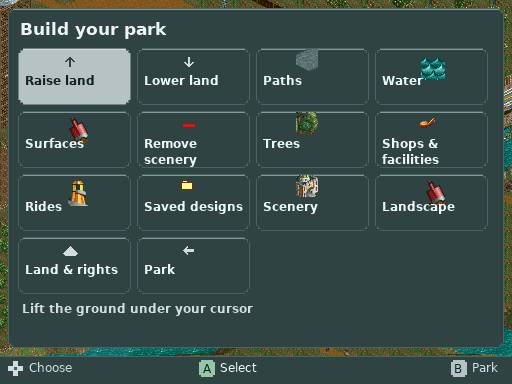
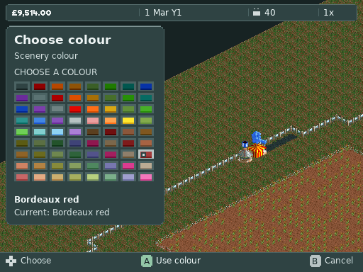
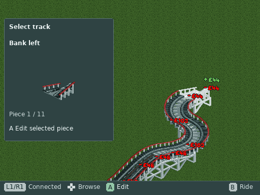
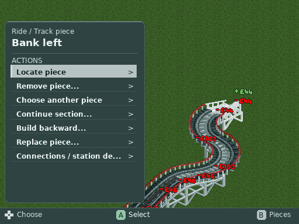
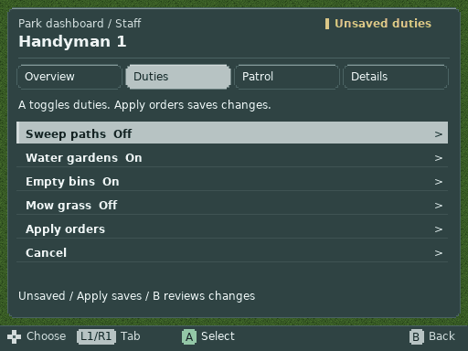
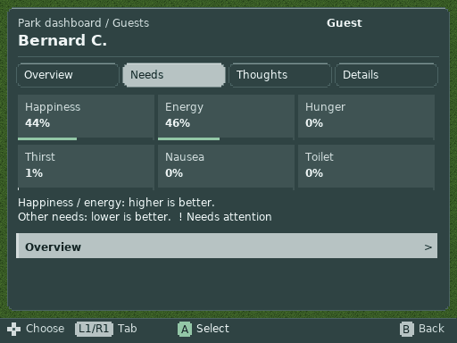

# Brick-native menu audit — RC4

Current implementation status: the remaining reachable BF01–BF10 workflows are implemented and native-verified in [BRICK-NATIVE-AUDIT-IMPLEMENTATION.md](BRICK-NATIVE-AUDIT-IMPLEMENTATION.md). The findings below describe the historical audit base. Physical Brick verification and the deferred Line/Fill bug remain open.

Audit base: canonical `1ac1b0bf9f0702349d90acf65f86384562eb0273` on
`handheld/modern-ui-paths`. This is a review and proposed next pass, not a new UI
implementation or a claim that every screen was physically played on a Brick.

## Finding

The main workspaces and visual catalogs establish a coherent handheld game.
The largest remaining mismatch is in secondary workflows: a visual front door
still opens parameter lists, engineering explanations and repeated review forms.
The next pass should finish those interactions, keeping the slate-green style,
current catalogs, simulation depth, save formats and single-row footer.

“Less text” is not a sufficient specification. Guest thoughts, park objectives,
news, finance ledgers and ride statistics contain useful game content. The target
is fewer instructions and implementation details, fewer navigation steps, and
more direct manipulation of the selected thing.

## Coverage and evidence

- Source audit: all **139 declared Menu.cpp Page states**, their shared presenters,
  current tab composition, input routes and special drawing paths. The inventory
  below includes compatibility states; a declaration alone is not proof that a
  normal player can reach a separate screen.
- Also reviewed: title/scenario entry, active park HUD, coaster/flat/maze building,
  scenery/terrain adjustment, patrol and pickup overlays, object/color pickers,
  shared confirmation and file/error surfaces outside the Page enum.
- Visual inspection: representative native captures in `captures/rc4/`,
  `captures/handheld-flow-rc3/` and `captures/footer-brick-rc1/`. Older images are
  used to inspect existing presentation patterns, with current source as the
  authority. They are not relabeled as new RC4 captures.
- No physical Brick available. Review of every state/value combination,
  translation and dense real park is still a device task. Path behavior is
  explicitly deferred; this review does not diagnose or fix Line/Fill.

## What should stay

The slate-green palette, 2× scale, build choice cards, object/material catalogs,
color grids, four-tab ride/people workspaces, needs meters, compact destructive
reviews, single-row controller footer, RC4 native track thumbnails and spatial
track selector are the foundations. Preserve the advanced operations and the
precise native costs/eligibility checks behind them.

## Highest-value changes

Priority is a UX judgment about ordinary play, not an invented simulation alert
severity. P1 means the next bounded usability pass; P2 is a follow-up refinement.

| ID | Priority | Menu / observed issue | Recommended experience |
|---|---|---|---|
| BF01 | P1 | Engineering language leaks into ordinary views: “Native invention records,” “Native cost,” “Cancel native pickup,” “Native restoration rules apply,” object descriptors and numeric origins. | Player names and consequences first. Keep diagnostic identifiers in an optional details/log surface. Keep actual failures visible and accurately worded. |
| BF02 | P1 | Ride prices/settings use Decrease → Increase → Review → Confirm forms; ordinary reversible edits feel like administering a database. | One focused value editor: large named value, direct left/right adjustment, current value when relevant, one explicit Apply, B discard. Retain an appropriate separate review for costly/destructive actions or substantive side effects. |
| BF03 | P1 | Entrances/exits still lead through a text list and a detail page with Tile, Height Z, direction number and generic maze/path explanations. | Select an entrance/exit highlighted in the park, show its station and state, then Move / Connect path / Remove. Use the same spatial principle as track editing. |
| BF04 | P1 | Saved designs expose object IDs, origin/direction coordinates, compatibility counts and a long policy/rollback warning list. | Native preview, design/vehicle names, cost and short Ready / Needs another vehicle / Missing scenery status. A selects a compatible vehicle visually. A details screen preserves exact affected content and partial-placement consequences. |
| BF05 | P1 | The map dedicates a large left column to tile coordinates, map dimensions, numeric rotation and a written color legend. | Give the map more area. Use labeled mode tabs, visual legend swatches and a compact selected-subject/ownership panel. Coordinates belong in optional details. |
| BF06 | P1 | The invention catalog is a “Native records” list with object-index fallback labels, despite native object previews already being available. | A visual researched-item catalog using the established picker. Human object name/category, researched/missing state, full selected-item preview. Only offer build handoff where existing construction support is valid. |
| BF07 | P2 | Uniform color and entertainer costume selection still use text/stepped values; patrol size uses separate width/height rows. | Reuse the color grid for uniforms and native peep sprites for role/costume selection. Put a visible brush-size control beside the patrol overlay. Preserve role-wide uniform scope and cost. |
| BF08 | P2 | Save/load browsing foregrounds filenames/full directories and Parent/Refresh rows; the park inspector does not draw available native preview images. | Lead with saved park name, native preview when present, date and a few meaningful stats. Keep quick slots fast. Put arbitrary folders/refresh behind Browse; retain exact filenames when needed. |
| BF09 | P2 | Repeated breadcrumb, title, status, body instructions, ACTIONS label and footer consume space; unsupported color channels remain prominent. | One title, one relevant status, compact labels, and contextual hints once. Collapse irrelevant rows; explain the selected disabled action. Keep meaningful units, prices, risks and full selected names. |
| BF10 | P2 | News handoffs work, but history/detail still looks like a generic list: Recent/Archive prefixes, Refresh, Next text page, Locate subject, Open management, Back and Dismiss together. | A readable message with its actual subject, primary contextual action and a small location/history affordance. Paginate only when the message needs it. Keep informational events, explicit dismissal and caller-aware Back. |

### BF01 — Language cleanup must be applied to live surfaces

Examples confirmed in current presenters:

| Current wording | Player-facing alternative / action |
|---|---|
| Research / Native invention records; Native records | Researched items; item count |
| Unavailable native object #… | Item unavailable; put the exact missing reference in details |
| Finances / Native weekly history | Finances / History |
| No native park messages | No park news yet |
| Native cost | Cost |
| Cancel native pickup | Cancel pickup |
| Native restoration rules apply | Explain the actual return outcome supported by the action, in ordinary language |
| Required: rct2…; Selected vehicle: descriptor | Display the object's human name and native thumbnail; retain identifier in details |
| Native policy: ALL design scenery omitted | This design will be placed without scenery, when that exact native outcome applies |
| Native placement failure has no universal scenery rollback | Preserve the material warning: some scenery may remain if placement fails; show exact resulting state |

Do not globally replace strings in the engine. Some native action failures are
necessary, and compatibility views may be dormant. Fix the reachable presentation
or translate a known result without suppressing its cause.

### BF02 — A shorter ordinary edit

Current ride editor source presents Current / Draft / Cost, four action rows, then
another confirmation. This pattern also affects other money/settings drafts.
Changing a price should feel like setting a price: focus its value, adjust, Apply,
and return to the previous selected row. Avoid treating a free reversible toggle
like demolition. Continue querying/executing the native action and guarding stale
targets. Vehicle changes that alter train/car counts need a concise consequence
summary; demolition, dismissal, save overwrite/discard and substantial construction
reviews keep deliberate protection.

### BF03 — Spatial entrance/exit management

`Menu.cpp` currently renders access source tile X/Y, world Z and direction, plus
path/maze notes even before a player has chosen an operation. These are real
engineering facts but poor primary controls. Highlight the exact native entrance
or exit, show “Station 1 entrance — Connected / Not connected” only when the native
state establishes it, and keep the existing native movement/reconnection rules.
Advanced station connection details remain accessible.

The RC4 track selector is the model for this treatment. Its action screen itself
can later be shorter: Locate is less useful when the piece is already centered;
Continue / Replace / Remove should be easier to distinguish from advanced station
and connection details. Keep all existing guarded operations.

### BF04 — Saved designs need the largest focused pass

Reachable sources are `designInspect`, `designVehicles`, `designOptions`,
`designWarnings`, `designConfirm`, `DesignAvailability::Lines` and
`Designs::WarningLines`. There are separate Height −/+, Automatic height,
Scenery on/off and compatibility/warnings routes, plus descriptor strings in
vehicle choices. Several choices can become direct controls adjacent to the real
native preview, with a compact selected-vehicle card and one scenery switch.

Warnings cannot merely disappear. If changing the vehicle changes effective
settings, show the meaningful result. If a missing object causes all design
scenery to be omitted, say so clearly. Preserve the actual sequential/native
partial-failure behavior; do not imply atomic rollback or invent replacements.
Design export's scenery selection also appends tile coordinates to entries; use
native park selection/highlighting where feasible and keep exact IDs in details.

### BF05 / BF06 — Show the map and the invention

The map's literal `Tile`, `Map`, `Rotation`, and native-color wording use much of
its sidebar. A map is the useful visual here. The invention catalog already calls
loaded `Object::DrawPreview`; a second object-rendering system is unnecessary.
Neither improvement should invent location/availability data or offer construction
for unsupported objects.

### BF09 — Reduce instructions, not game information

The guest Needs screen is a good example: useful meters sit above two persistent
sentences about which direction is good and an otherwise redundant Overview row.
Directional meter treatment, ordinary labels and focused help could carry that
meaning without repeating the tutorial every visit. Native thresholds and meter
normalization remain unchanged.

Staff Duties repeats a toggle instruction, an Apply instruction, an unsaved
summary and the footer. Keep the unsaved marker and clear Apply/Discard controls;
use visual checkbox/toggle state and show help only where it adds information.
Terrain adjustment likewise repeats shortcuts in its heading, body and footer.
Unsupported secondary/tertiary channels should not occupy the same emphasis as
the useful primary color. An unavailable but important action still needs a clear
reason, without fabricating a cause.

## Menu-family review

| Family | Assessment | Specific direction |
|---|---|---|
| Title / new park / scenario selection | Mostly established; written scenario goals are appropriate. | Keep the primary start/load choices and genuine scenario descriptions. Avoid developer labels in failure states. |
| Park / pause | Mostly established. | Keep quick save/resume/exit obvious; reduce generic “Park / Pause” framing and duplicate Back rows where B already serves that role. Protect unsaved exits. |
| Controller guide | Needs refinement. | “Controls from menu entry” reads like an input dump. Use a controller diagram and focused Park / Build / Menus sections derived from real mappings; preserve access to less-used shortcuts. |
| Dashboard rail / Park workspace | Keep foundation. | The rail is useful navigation. Shorten deep breadcrumbs; avoid repeating status as both header and metric unless useful. |
| Build choice cards | Keep. | Strong handheld pattern. Some categories mix tools and destinations; do not reopen a general redesign or remove quick tools just to make the grid symmetrical. |
| Ride / shop / tree / scenery catalogs | Keep. | Native thumbnails and focused full names should remain; improve selected-only unavailable reasons. |
| Color / material pickers | Keep; reuse. | This is the visual language to extend to uniforms and other genuine visual choices. |
| Single / connected / Line / Fill paths | Deferred. | Preserve the accepted visual modes and material selector. No gameplay/accounting claim from this audit. |
| Coaster active building | Improved by RC4; device retest. | Keep native ghost, cost and piece thumbnail. Review repeated slope/bank/height text only after the physical construction loop is tested. |
| Track-piece catalog | Keep RC4 foundation. | Native images, full names and compatible groups are appropriate. Preserve eligibility and focus. |
| Existing track selection/actions | Substantial improvement, with one secondary text list left. | Keep spatial selection; simplify the action grouping and tuck raw station/sequence details away. |
| Flat-ride placement / station access steps | Keep foundation. | Guided in-park steps work; one relevant status/cost at a time. |
| Maze / other supported active building | Mixed; source reviewed. | Keep native geometry; replace “Choose native maze cell” and redundant mode instructions with ordinary task language. Do not drop specialist functions. |
| Ride Overview | Keep tabs and summary. | Open/Close/Test can be one coherent status control; do not show a full free-cost review for every ordinary status change. Preserve validation and failures. |
| Ride Operations / Vehicles / Dispatch / Maintenance | High-impact secondary work. | Group values by how players think: operating mode, train configuration, dispatch conditions, maintenance. Use direct values/toggles and actual native vehicle previews; retain all supported settings. |
| Ride Statistics / Customers / Earnings / Graphs / Stations | Mainly legitimate information. | Keep numeric data and native graph units; improve chart-first hierarchy. Station coordinates are optional details. |
| Ride Appearance / Music / Naming | Mixed. | Reuse color grids and native styles/vehicles; reduce free-change confirmations; keep meaningful names and supported music choices. |
| Existing entrances / exits | P1. | Spatial selection and concise station/connection state, not coordinates first. |
| Shops / prices / appearance / demolition | Mixed. | Shop view has useful compact economics. Make price edits direct; place destructive Demolish after ordinary actions. Color selection already provides a good foundation. |
| Staff roster / hire / employee tabs | Mostly good structure, some settings-list feel. | Native role sprites and wages for hire; clear duty toggles; remove repeated instructions. Keep precise role/order restrictions. |
| Staff costume / uniform | P2. | Native sprite costume picker and shared color grid; clearly identify role-wide uniform changes. |
| Patrol painting / clearing | Mixed. | Map overlay and brush controls first; tile count can remain secondary. Retain confirmation for clearing the whole assigned patrol. |
| Guest roster / groups / filters | Mostly appropriate lists. | Lists of actual guests/thought groups are meaningful. Keep selection/scroll context and full selected names; simplify filter terminology and top controls. |
| Guest Overview / Needs / Thoughts / Details | Keep tabs; small hierarchy refinement. | Live needs and thoughts are the content. Reduce tutorials and free tracking confirmation; no need to turn guest thoughts into icon-only cards. |
| Pickup / person placement / cancel | P1 wording, P2 flow. | The person is already visible in the park. Replace engineering restoration language with the true outcome; keep a safe native return/cancel path. |
| Park map / subject lists | P1 map; appropriate subject lists. | Larger map, visual legend, selected subject first; remove numeric rotation/dimensions from the default view. |
| News / detail / history | RC4 routing improved; P2 presentation. | Keep native events and Back context; remove manual Refresh emphasis and unnecessary paging controls. Never infer a subject from prose. |
| Park awards / objectives / park history | Mainly real game content. | Keep descriptions, dates and native graphs. Short headings, selected detail, no engineering qualifiers. |
| Finance Overview / Ledger / History / Controls | Keep tabbed structure and real accounting. | Ledger rows need text. History should foreground the chart; direct loan/price editors and ordinary language remove the settings-console feel. |
| Research Project / Funding & priorities | Keep native stage and recurring cost. | Priority checkboxes and a clear funding control; collapse unavailable groups or explain the selected one; reduce draft/tutorial duplication. |
| Research catalog / invention detail | P1. | Visual catalog and human names; native object IDs and implementation availability labels move to optional details. |
| Marketing active / new / target / duration / confirm | Mostly coherent. | Active campaigns and a financial launch summary are useful. Duration is a direct stepper; native ride thumbnails can help target selection. Keep real total and ongoing duration. |
| Saved-design catalog / files / vehicle / placement | P1. | Real design preview and compatible vehicle selection; collapse diagnostic details, retain concise actionable warnings and real partial-failure disclosure. |
| Save-design / scenery inclusion / export | P2, specialist. | Show what will be exported, selected scenery in park, readable name; retain overwrite protection and actual export constraints. |
| Save / load / quick slots / file inspection | Quick slots good, browsing P2. | Park identity and existing native preview images first; filesystem paths and refresh are advanced. |
| Rename / sign text / save name / search keyboard | Functional, P2. | Consistent controller keyboard, clear Space/Delete/Case/Done affordances; avoid another full review for harmless naming unless a specific consequence needs it. |
| Confirmations / failure / changed-target states | Keep safeguards; fix copy. | Name the real action (“Demolish ride”, “Start campaign”) instead of generic Confirm. Preserve financial cost, consequence, selected target and native errors. |

## Next implementation order

1. **Shared ordinary edits and copy:** BF01/BF02/BF09, starting with price, free
   toggles, pickup, research and current live error/status strings. Preserve dirty
   draft and native stale-target guards; keep a deliberate destructive review.
2. **Spatial entrance/exit management plus saved-design construction:** BF03/BF04.
   Reuse the new spatial selector and native renderers, not a new visual system.
3. **Map and invention catalog:** BF05/BF06, followed by staff customization.
4. **News/history, save browsing and remaining low-frequency details:** BF07–BF10.

Done means that a player can identify the selected thing, its actual state/cost,
and the next useful action at 512×384 without reading implementation notes.
A common price/status edit should not require an extra review screen unless a
real consequence warrants it. A confirmation names the action and shows only
material consequences. Advanced native options remain discoverable in their
proper context. Prose needed to understand the park stays readable and complete.

## Supplementary test cleanup

The two information drivers left unfinished in the prior RC4 report have now been
migrated to the established tabbed routes, without changing game/UI behavior.
FinanceResearchInformationTests uses named ledger/catalog actions, current
finance tabs and dashboard news navigation. ParkMapInformationTests selects
current Park/Records tabs and named map/news/awards/history actions. Existing
native assertions, bounds, stale-subject checks, calendar/accounting and save/load
checks remain. Both pass in the initialized native headless/SDL fixture. The
optional original-asset graph-raster/capture branches were not rerun in this audit.
Prior RC4 package reports remain historical records of their original results;
this audit and its new evidence supersede the two-driver limitation for these
headless navigation checks. No new ARM package is needed for test/document-only
changes.

## Declared-state inventory

This source inventory is a completeness check, not a count of separately reached
runtime screens. Several legacy states share current presenters or are replaced
by tabs. Do not spend the next implementation pass polishing unreachable views.

| State | Audited family |
|---|---|
| `park` | Park menu and help |
| `controls` | Park menu and help |
| `build` | Build choices |
| `paths` | Paths (deferred) |
| `pathOptions` | Paths (deferred) |
| `pathSurfacePicker` | Paths (deferred) |
| `terrainMaterialPicker` | Terrain / land rights |
| `pathUndoConfirm` | Paths (deferred) |
| `treePicker` | Trees |
| `sceneryCategory` | Scenery / signs |
| `sceneryPicker` | Scenery / signs |
| `sceneryOptions` | Scenery / signs |
| `sceneryClearOptions` | Scenery / signs |
| `sceneryClearConfirm` | Scenery / signs |
| `sceneryGroups` | Scenery / signs |
| `sceneryStyle` | Scenery / signs |
| `sceneryStyleEditor` | Scenery / signs |
| `sceneryStyleConfirm` | Scenery / signs |
| `areaOptions` | Terrain / land rights |
| `terrainPaintConfirm` | Terrain / land rights |
| `rightsOptions` | Terrain / land rights |
| `rightsConfirm` | Terrain / land rights |
| `sceneryName` | Scenery / signs |
| `scenerySearch` | Scenery / signs |
| `sceneryConfirm` | Scenery / signs |
| `shopPicker` | Shop / facility |
| `ridePicker` | Ride catalogs / track catalog |
| `designPicker` | Saved-design placement |
| `customChoice` | Build choices |
| `trackPiecePicker` | Ride catalogs / track catalog |
| `designConfirm` | Saved-design placement |
| `designOptions` | Saved-design placement |
| `dashboard` | Park menu and help |
| `overview` | Park menu and help |
| `overviewConfirm` | Park menu and help |
| `parkMap` | Park map / subjects |
| `parkNews` | News / awards / history |
| `parkNewsDetail` | News / awards / history |
| `parkAwards` | News / awards / history |
| `parkHistory` | News / awards / history |
| `mapSubjects` | Park map / subjects |
| `mapSubject` | Park map / subjects |
| `finances` | Finance |
| `financeLedger` | Finance |
| `financeHistory` | Finance |
| `financeEditor` | Finance |
| `financeConfirm` | Finance |
| `staff` | Staff management |
| `staffInspect` | Staff management |
| `staffStats` | Staff management |
| `staffOrders` | Staff management |
| `staffHire` | Staff management |
| `staffDismiss` | Staff management |
| `staffRoles` | Staff management |
| `staffCostumes` | Staff management |
| `staffName` | Keyboard / naming |
| `staffNameConfirm` | Keyboard / naming |
| `staffSummary` | Staff management |
| `staffUniform` | Staff management |
| `staffPatrolOptions` | Staff patrol |
| `staffPatrolClear` | Staff patrol |
| `guests` | Guest management |
| `guestRoster` | Guest management |
| `guestInspect` | Guest management |
| `guestNeeds` | Guest management |
| `guestThoughts` | Guest management |
| `guestSpending` | Guest management |
| `guestInventory` | Guest management |
| `guestText` | Guest management |
| `guestGroups` | Guest management |
| `guestName` | Keyboard / naming |
| `guestFilterName` | Keyboard / naming |
| `guestNameConfirm` | Keyboard / naming |
| `guestTracking` | Guest management |
| `guestPreferences` | Guest management |
| `guestRideHistory` | Guest management |
| `peepOptions` | Pickup / placement |
| `peepCancel` | Pickup / placement |
| `ridesRoster` | Ride management |
| `ridesInspect` | Ride management |
| `trackBlocks` | Built-track editing |
| `trackBlock` | Built-track editing |
| `trackContext` | Built-track editing |
| `trackRemoveConfirm` | Built-track editing |
| `trackReplaceConfirm` | Built-track editing |
| `trackSpeedConfirm` | Built-track editing |
| `ridesAccess` | Ride entrances / exits |
| `accessManage` | Ride entrances / exits |
| `accessPoint` | Ride entrances / exits |
| `accessReview` | Ride entrances / exits |
| `ridesStats` | Ride management |
| `ridesCustomers` | Ride management |
| `ridesStations` | Ride management |
| `ridesEarnings` | Ride management |
| `ridesGraphs` | Ride management |
| `ridesOperations` | Ride management |
| `ridesMaintenance` | Ride management |
| `ridesVehicles` | Ride management |
| `ridesDispatch` | Ride management |
| `ridesMusic` | Ride management |
| `ridesAppearance` | Ride management |
| `ridesName` | Keyboard / naming |
| `designName` | Keyboard / naming |
| `designScenery` | Saved-design export |
| `designExport` | Saved-design export |
| `ridesPrice` | Ride management |
| `ridesConfirm` | Ride management |
| `research` | Research |
| `researchCatalog` | Research |
| `researchItem` | Research |
| `researchEditor` | Research |
| `researchConfirm` | Research |
| `marketing` | Marketing |
| `marketingActive` | Marketing |
| `marketingTypes` | Marketing |
| `marketingEditor` | Marketing |
| `marketingTargets` | Marketing |
| `marketingConfirm` | Marketing |
| `ride` | Ride management |
| `shop` | Shop / facility |
| `shopPrices` | Shop / facility |
| `shopAppearance` | Shop / facility |
| `shopAppearanceEditor` | Shop / facility |
| `shopAppearanceReview` | Shop / facility |
| `shopDemolish` | Shop / facility |
| `save` | Save / load |
| `load` | Save / load |
| `parkInspect` | Save / load |
| `designFiles` | Saved-design placement |
| `designInspect` | Saved-design placement |
| `designVehicles` | Saved-design placement |
| `designWarnings` | Saved-design placement |
| `parkFiles` | Save / load |
| `saveFiles` | Save / load |
| `saveName` | Keyboard / naming |
| `saveReview` | Save / load |
| `overwrite` | Save / load |
| `discard` | Save / load |
| `exit` | Save / load |

## First implementation pass

See [BRICK-FEEL-FIRST-PASS.md](BRICK-FEEL-FIRST-PASS.md) for implemented scrolling,
ordinary numeric edits, spatial access selection and uniform palettes, native
verification and the exact remaining scope. This audit remains the broader
inventory; its historical observations are not claims that all findings remain
unchanged or that the whole pass is complete.
