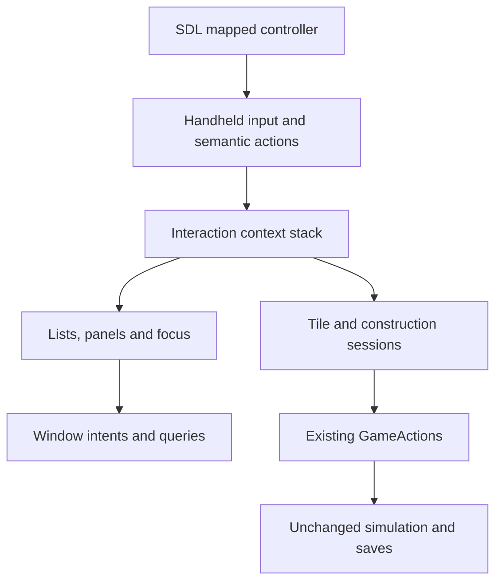

# OpenRCT2 Handheld: architecture and implementation plan

Inspection date: 2026-10-05. Upstream baseline: `OpenRCT2/OpenRCT2`, `develop`, commit `21afdbc55008335cd70e72a53d465608f9f645ac`. Local development branch: `handheld/park-explorer`. This is a source fork foundation, not a completed handheld port. See `VALIDATION.md` for the actual verification status.

## Recommendation

Keep OpenRCT2's engine, park renderer, game actions, object system, and save formats. Introduce an opt-in interaction layer in `src/openrct2-ui/handheld/`, with context-specific controllers and compact screens implemented using the existing window/drawing infrastructure. Avoid a second renderer, a duplicate game model, and a universal “move mouse to widget” adapter.

This is technically plausible. The existing action API makes controller-driven commands possible without mouse injection. It is nevertheless a substantial UI engineering project: construction state and interaction policy are often embedded in window classes, and the current widgets have no general controller focus/navigation contract. Running an old PortMaster executable does not validate the new upstream version's ABI, performance, or usability.

Treat 512×384 as the **logical canvas**. The proposed Brick profile uses a 1024×768 output and `window_scale=2`, with automatic DPI inference off. Confirm the framebuffer and effective SDL drawable size on the device. This integer scaling establishes the canvas; it does not make existing desktop layouts into acceptable handheld screens.

## Architecture findings and exact source map

Paths below are relative to the repository root and refer to the pinned revision above.

| Concern | Files / symbols | Finding and implication |
|---|---|---|
| SDL event entry | `src/openrct2-ui/UiContext.cpp`: `UiContext::ProcessMessages`, constructor | Polls SDL events; directly updates cursor state, queues mouse presses, processes keyboard/text, and forwards remaining events to `InputManager`. SDL initialisation requests VIDEO and JOYSTICK. A controller mode needs explicit GAMECONTROLLER initialisation and interception before raw events reach shortcuts. |
| Mouse input | `src/openrct2-ui/input/MouseInput.{h,cpp}`; `src/openrct2/Input.{h,cpp}` | Stateful normal, dragging, dropdown, tool and viewport interaction; not just button delivery. Leave intact for desktop and fallback. |
| Keyboard and existing gamepads | `src/openrct2-ui/input/InputManager.{h,cpp}` | Upstream has analogue scrolling, mapped-controller discovery, raw joystick buttons/hats and shortcut dispatch. Existing event conversion accepts both JOY and CONTROLLER events as `joyButton`, losing device identity. Its refresh clears controller pointers and opens controllers every five seconds without balancing those opens in that method. Handheld mode should own its controller lifetime and avoid the duplicate raw/mapped path. These are code-inspection findings, not a hardware diagnosis. |
| Shortcuts | `input/ShortcutManager.{h,cpp}`, `ShortcutInput.cpp`, `ShortcutIds.h`, `Shortcuts.cpp` under `src/openrct2-ui` | `RegisteredShortcut::action` is a callable function; semantic IDs cover zoom, rotation, pause, windows and more. Useful for a small adapter. Some construction shortcuts invoke `onMouseUp` on known widget indices, so not all are clean domain APIs. |
| Viewport movement | `MouseInput.cpp`: `InputScrollViewport`, `InputScrollViewportSmooth`; `src/openrct2/interface/Viewport.{h,cpp}`; `src/openrct2-ui/windows/Main.cpp` | Direct panning and camera rotation exist. The smooth helper accepts a target window, avoiding cursor-based viewport selection. Zoom-aware movement and map limits remain upstream responsibilities. |
| Map selection | `src/openrct2-ui/interface/ViewportInteraction.{h,cpp}`; `Viewport.cpp`: `GetMapCoordinatesFromPos`, `GetMapCoordinatesFromPosWindow` | Existing picking resolves rides/entities/entrances into windows/intents. Useful for a fixed reticle first. Later construction needs explicit map coordinates, elevation and layer selection; a screen point alone is ambiguous for stacked scenery and underground track. |
| Window management | `src/openrct2-ui/WindowManager.cpp`; `src/openrct2/ui/WindowManager.h`; `src/openrct2/interface/WindowBase.{h,cpp}`, `Window.cpp`, `WindowClasses.h` | `IWindowManager` creates, finds, closes, opens details and dispatches intents. Can host handheld overlays and screens without replacing desktop. `gWindowList` and window flags provide ordering and lifetime. Respect `canClose()` and existing modal flows. |
| Widget focus | `WindowBase.h`; `src/openrct2-ui/interface/Widget.{h,cpp}`; `src/openrct2/interface/Widget.h` | Widgets have mouse, dropdown, scroll and tool callbacks. There is no complete general D-pad focus graph. `WindowBase::focus` means viewport coordinate/entity focus, not keyboard/controller widget focus. Add explicit semantic focus to handheld screens rather than inferring every desktop rectangle. |
| Toolbar and navigation | `src/openrct2-ui/windows/TopToolbar.cpp`, `TitleMenu.cpp`, `Options.cpp`, `GameStatusBar.cpp`, `ParkInfoPanel.cpp`, `NewsTicker.cpp`; `src/openrct2/windows/Intent.h` | High-frequency functions already lead to game actions or window intents. A Build list and park dashboard can call them directly. Opening a desktop window is only an interim access path, not a completed handheld workflow. |
| Active construction tools | `src/openrct2-ui/interface/Window.cpp`: `ToolSet`, `ToolCancel`; `WindowBase.h`: `onToolUpdate/Down/Drag/Up/Abort` | Tool ownership and cleanup are reusable. Most callbacks take screen coordinates and inspect globals/modifiers. A tile placement session should expose explicit target coordinates and use existing actions/ghost mechanisms, rather than inventing fake pointer drags. |
| Ride creation and coaster construction | `src/openrct2-ui/windows/NewRide.cpp`, `RideConstruction.cpp`, `TrackDesignPlace.cpp`; `src/openrct2/ride/RideConstruction.{h,cpp}`; `src/openrct2-ui/ride/Construction.{h,cpp}`; `src/openrct2/actions/ride/`, `actions/track/` | `RideConstructNew` and `BuildSpecialElementsList` already expose ride creation and valid special-piece enumeration; reuse these rather than inventing a reduced track catalog. Ride creation/track placement actions already exist. Track selection, geometry, entrance/exit placement, preview and construction states span engine helpers and a large window implementation. Requires incremental extraction of semantic operations. |
| Paths | `src/openrct2-ui/windows/Footpath.cpp`; `src/openrct2/actions/footpath/FootpathPlaceAction.*`, `FootpathRemoveAction.*`, `FootpathLayoutPlaceAction.*`; `src/openrct2/world/Footpath.*`; `src/openrct2-ui/interface/ViewportQuery.{h,cpp}` | Existing on-land and bridge modes, provisional previews, path type/queue state, slope and height support. Start with one explicit tile/path session using Query/Execute, then add elevated paths/queues and bridge continuation. |
| Scenery / terrain | `src/openrct2-ui/windows/Scenery.cpp`, `Land.cpp`, `Water.cpp`, `ClearScenery.cpp`; `src/openrct2/actions/scenery/`, `actions/terraform/` | Placement, repaint and removal actions can be reused. Quarter-tile positions, wall edges, elevation, stacked items and modifier-driven placement need explicit controller modes. Terrain drag cannot simply become a generic confirm button. |
| Staff | `src/openrct2-ui/windows/Staff.cpp`, `StaffList.cpp`, `PatrolArea.cpp`; `src/openrct2/actions/peep/StaffHireNewAction.*`, `PeepPickupAction.*` | Reuse hire/pickup/patrol actions. Tile focus can place a staff member; selection/painting of patrol areas needs its own session. |
| Information and management | `src/openrct2-ui/windows/Ride.cpp`, `RideList.cpp`, `Guest.cpp`, `GuestList.cpp`, `Staff.cpp`, `Finances.cpp`, `Research.cpp`, `Park.cpp`, `News.cpp` | Existing models, queries and actions remain authoritative. New readable list/detail views should adapt these, not maintain copies of finances, ride status, etc. Preserve access to less-common properties through nested views. |
| Text and font metrics | `src/openrct2/drawing/Font.{h,cpp}`, `Text.{h,cpp}`; `src/openrct2/config/Config.cpp`: `ReadFont`, `WriteFont` | Sprite fonts use small fixed line heights (10/10/6 in the inspected source); TTF has separate sizes/line heights. Enlarging font configuration alone will overflow fixed desktop layouts. New screens should measure strings, wrap and budget larger rows. |
| Resolution and UI scale | `UiContext.cpp`: `CreateWindow`, `OnResize`, `InferDisplayDPI`; `src/openrct2-ui/drawing/engines/HardwareDisplayDrawingEngine.cpp` | Current minimum SDL window is 720×480. Logical width/height are output dimensions divided by `windowScale`; existing integer-scale path is useful. Handheld mode can lower the minimum without affecting desktop. |
| Configuration | `src/openrct2/config/Config.{h,cpp}`; `src/openrct2-ui/input/ShortcutManager.cpp`; `src/openrct2/command_line/RootCommands.cpp` | General INI, font configuration and shortcut bindings already exist, as do custom data paths. Initial proof uses a UI-only launch environment switch; promote to a documented config/CLI option once the interaction contract stabilises. Keep handheld preferences out of park saves. |
| Platform and build | `CMakeLists.txt`, `src/openrct2/CMakeLists.txt`, `src/openrct2-ui/CMakeLists.txt`, `cmake/platform.cmake`; `src/openrct2/platform/Platform.Linux.cpp`, `Platform.Posix.cpp`; `src/openrct2-ui/UiContext.Linux.cpp` | C++20, CMake 3.24+, and a modern compiler; top-level file documents GCC 12+. Linux platform paths and SDL backend exist. Linux native file dialogs may invoke desktop tools, so handheld browsing must eventually stay in-game. |
| Saves / engine actions | `src/openrct2/actions/GameActionRunner.{h,cpp}`, `GameAction.hpp`; `src/openrct2/park/ParkFile.*`, `ParkImporter.cpp` | Query/Execute provide the authoritative validation/command boundary. No park schema or simulation modifications are needed for this layer. Preserve same-version OpenRCT2 compatibility; do not promise that new `.park` saves open in older releases or original RCT2. |

## Recommended separation

Keep the controller transport independent of game state. It owns discovery, instance IDs, neutral rearming, held directions, repeat timing and semantic actions. A screen/session owns what those actions mean. Priority should be modal prompt → text entry → active screen → placement session → map. Consuming an action must prevent it reaching another context or the legacy shortcut path.

Use typed focus IDs tied to data identity (ride ID, object ID, selected row), not ephemeral list indexes or widget coordinates. Keep focus stable on refresh; clamp it when an item disappears. Give each context a visible action legend. Bindings should be data-driven once there are multiple contexts; the first proof's mapping is deliberately isolated in one switch.

Use upstream `Query` for cost/permission/placement feedback and `Execute` for committed changes. Preserve callbacks and upstream error handling, including asynchronous/network outcomes where relevant. Do not directly mutate rides, cash, paths or staff from controller code. Do not call `Execute` each frame to make a preview; use the existing ghost/provisional paths and cleanup conventions.

For construction, maintain an explicit `(x, y, z, direction, selection/layer)` target. Move in screen-relative cardinal directions translated through camera rotation. Offer elevation/stack selection explicitly. D-pad navigation must be different from continuous map panning; keep this distinction in session types. No requirement for analog sticks or pointer precision.

The first proof reuses the existing viewport picking function at a fixed centre reticle. This is transitional selection, not the final tile-construction abstraction. That function also retains upstream balloon/duck interactions. The D-pad itself never moves a mouse cursor.

## First implementation: park explorer

Runtime enablement: `OPENRCT2_HANDHELD=1`. Unset it (or use any value other than `1`) for normal desktop behaviour. Restart to switch modes; it is a launch option in this prototype.

| Button | Current narrow proof |
|---|---|
| D-pad | Continuous, time-based map pan; diagonal speed normalised |
| A | Resolve the item beneath the fixed reticle through existing viewport selection |
| B | Dismiss error/cancel active tool, close dropdown, or close top floating window |
| X | Rotate camera clockwise |
| L / R | Zoom out / in around the view, without pointer targeting |
| Start | Pause via the existing action; temporary Phase 1 mapping |
| Y / Select | Reserved for later contexts |

Only the playing scene is supported. Existing desktop information windows still appear. Map controls are suspended while floating windows are open; B closes them where appropriate. Text entry, load/save, overwrite/save prompts, console/chat and shortcut rebinding are deliberately excluded from this proof; use fallback input. Menu navigation and save/load are not controller-complete.

The module owns one mapped SDL controller, ignores additional devices for this prototype, consumes raw duplicates, closes its handle, and rearms only when buttons return to neutral. Disconnect/focus-loss clears queued commands and pan accumulation. Panning is capped after long frame stalls. Controller mapping comes from SDL / PortMaster's mapping string; unknown devices are not assigned guessed raw button numbers. Physical A/B labels must be checked on Brick.

The reticle uses a small input-transparent overlay window. That allows normal map picking through it and uses the window compositor's existing scroll-blit clipping instead of repainting the entire park for a marker. No new shaders, textures or background worker.

### Exact change footprint

- New `src/openrct2-ui/handheld/ControllerInput.{h,cpp}`: controller ownership, lifecycle, mapped events, held panning, semantic actions, launch switch.
- New `src/openrct2-ui/handheld/Explorer.{h,cpp}`: game-context guards, semantic dispatch, direct panning, focus overlay.
- `UiContext.cpp`: raw event hook before legacy dispatch; mode-specific 512×384 window minimum.
- `input/InputManager.{h,cpp}`: own/update handheld transport; retain existing desktop path when mode is off; suppress pointer-edge scrolling in handheld mode.
- `src/openrct2/interface/WindowClasses.h`: one UI-only overlay class ID. No save-format change.
- `test/handheld/`: standalone SDL virtual-controller test executable.
- `scripts/handheld/`, `packaging/handheld/`, `docs/handheld/`: build/test instructions and staging templates.

## ARM / TrimUI route

The examined PortMaster package advertises **aarch64** in `ports/openrct2/port.json`. Its launcher sources `control.txt` and the CFW-specific helper, sets SDL controller mapping and private libraries, extracts an `engine.zip`, and starts `gptokeyb` before OpenRCT2. The included controls expect analog sticks for mouse and map movement. It is not a native D-pad UI.

Its porter documents Debian 11/Bullseye AArch64 libraries and an SDL simulated-cursor patch. The package bundles older ICU/SSL/FLAC/zip libraries. Reuse layout and launcher conventions, but do not apply that old patch blindly to the current source. Do not assume the included libraries match the new executable.

Recommended build route:

1. Pin the above source commit and all OpenRCT2 assets via `assets.json`; establish and archive a native build before patching.
2. Inspect the user's actual NextUI PortMaster runtime: architecture, libc/loader, SDL version/backend, controller mapping, and screen size. A small read-only collection script is included. “ARM Linux” alone is not an ABI specification.
3. Use an AArch64 toolchain with GCC 12+ (or compatible modern Clang) targeting a sysroot no newer than that runtime. A modern compiler and old compatible glibc must be handled separately. Pin the builder image/SDK digest and dependency versions before calling the target build reproducible.
4. Start with software park rendering plus SDL presentation (`SOFTWARE_HWD`); exclude the optional desktop OpenGL renderer in the target build if needed. Keep simulation, scripting, multiplayer, codecs and text capabilities unless a separately justified platform issue requires adjustment. Turning off Discord integration is not a gameplay change.
5. Cross-build both UI and CLI. Upstream deliberately skips sprite-data generation when cross-compiling: generate `g2.dat`, `fonts.dat`, `palettes.dat`, `tracks.dat` with the **same commit's native CLI**, and copy them to the target build/install staging directory. Also install languages, object pack, sequence, audio/music packs according to the pinned asset manifest. An executable alone is insufficient.
6. Inspect `readelf` machine/interpreter/NEEDED/version requirements. Bundle compatible non-system dependencies with their licenses; use the runtime's appropriate SDL/GPU backend. Do not package the development host's Ubuntu libc or SDL stack as a shortcut.
7. Stage a separate `openrct2-handheld` port with its own user-data directory and a disposable copied park. Export `OPENRCT2_HANDHELD=1` and SDL mapping. Do not run the existing mouse-mapping `gptokeyb` profile in parallel with native controls. Verify exit handling separately because removing that process also removes its helper hotkeys.
8. Boot and exercise the exact archive on Brick before calling it a hardware build. Record small/medium/large park timing and memory against the same upstream executable with handheld mode off. Simulation work does not become cheaper just because the display is smaller.

This environment has a native x86_64 build toolchain, but no validated TrimUI sysroot, AArch64 toolchain, container runtime, or physical device. The included cross-toolchain and launcher files are **staging proposals**, not evidence of a working ARM release. A host Linux executable must not be copied to the Brick.

Original assets: use a legitimately owned RCT2 installation, preserving `Data` (including `g1.dat` and sound data), `ObjData`, `Scenarios`, and `Tracks` where present. OpenRCT2 data packs are additional engine data, not a replacement for original graphics. RCT1 plus expansion data is optional for its content. Do not bundle proprietary assets in this fork. Original RCT2 save-format limits still apply if exporting to an old format.

## Main risks and stop/go gates

| Risk | Consequence | Concrete gate |
|---|---|---|
| New upstream + old handheld runtime | Binary links on host but cannot start on Brick | Loader and symbol-version audit, then real launch before Phase 2 |
| No generic widget focus | Hundreds of windows cannot be made controller-native with one patch | Build two explicit list/detail screens before proposing a generic screen framework |
| Construction globals/window-local state | Hidden dependencies on modifiers, previews and tool ownership | One path tile: valid preview, cost/error query, place, cancel, reopen, save/load |
| Picking layered isometric objects | Reticle can select the wrong ride or height | Explicit tile/elevation/layer navigation before scenery and coasters |
| Desktop window dimensions and text | Enlarged fonts clip; 512×384 screenshots mislead | On-device reading of costs, names and alerts; then compact screen layouts |
| Input ownership and lifecycle | Duplicate confirm, held input after wake, mode leakage | SDL lifecycle tests plus real button/focus/suspend tests |
| Park size and simulation budget | Smooth menu with slow simulation | Measure existing small/large parks; never simplify simulation to meet an unmeasured target |
| Save-version compatibility | Newer parks rejected by older OpenRCT2 | Round-trip using the exact baseline version; separately state old-format limits |
| Device power/sleep/exit integration | Lost session or stuck inputs | Manual save/load and repeated suspend cycles; application focus tests alone do not prove sleep support |
| Upstream maintenance | Merge conflicts spread through engine/UI | Keep adapters local, small semantic extractions, no duplicated construction engine |

## Phased roadmap with hardware acceptance criteria

| Phase | Work | Exit / physical test |
|---|---|---|
| 0: Baseline | Pin source/assets; native compile; target ABI/toolchain; package original-data instructions; record performance | Unmodified build boots a known park on Brick; record compiler/SDK/dependencies and executable hash |
| 1A: Input proof (this patch) | Isolated mode; mapped controller lifecycle; direct pan, reticle inspection, back, camera controls; mouse fallback | Native build + virtual controller tests, followed by target compile and real pan/inspect test; do not call all of Phase 1 done without hardware |
| 1B: First device release | Close remaining ABI/SDL gaps; supply archive; launch directly into copied park; visible button help and exit path | Ten-minute test: all buttons, diagonal pan, all camera rotations/zoom, pause, focus loss/disconnect, no duplicate input |
| 2: Handheld shell | Controller main menu and in-game pause/options; simple save/load first; Build on Select and dashboard on Start; compact HUD; measured typography/focus; text-entry plan | Start → load → inspect → pause → save → quit without a mouse; readable at normal handheld distance |
| 3A: Construction foundation | Tile/elevation/direction focus; cost preview and error feedback; paths + shops; removal selection/confirmation | Build connected paths to a working shop, cancel/reopen tool, remove chosen tile, save/reload unchanged park |
| 3B: Basic construction breadth | Flat rides, entrances/exits/queues; staff and patrols; scenery categories, quarter-tile/edge placement; scoped demolition; terrain/water sessions | Build/open a flat ride, assign staff and decorate; every session handles invalid targets and cancellation; measure tool responsiveness |
| 4: Management | Rides/staff/guests lists and details; finances, pricing, research, park info and alerts; predictable tabs/back/history | Complete a daily management session with renamed ride, price change, hiring, research change, alert navigation and save; retain less-common settings |
| 5: Coasters | Extract semantic track operations incrementally; direction/curve/slope/bank, specials, heights, brake speeds, lift and ride-specific options; ghost/error feedback; entrance/exit and test workflows | Build and modify representative simple, banked, inverted/special-piece coasters; confirm advanced options remain reachable; preserve upstream placement validation |
| 6: Device polish | Startup/assets caching where measured, performance, button repeats, accidental-input guards, contextual help, visual hierarchy, error recovery, sleep/resume and save robustness | Repeated short sessions over multiple days; physical-device feedback controls typography and timing decisions; compare save round-trips and park behaviour |

Coaster navigation proposal: horizontal selection of major geometry families, contextual sublists for pieces, separate elevation/slope/bank adjustment pages, a persistent ghost/cost summary, and an explicit commit action. Keep an advanced properties page rather than dropping uncommon features. B should back out of a selection before removing built track; track removal/refunds are upstream actions, not a promise of arbitrary undo. Validate this with a single ride type before broadening it.

Every device milestone should carry commit ID, SDK/dependency versions, matching engine data, license/source archive, control sheet, precise known limitations, and a short test checklist. If target compilation is blocked, label the milestone incomplete instead of replacing hardware acceptance with desktop screenshots.

## Primary references

- [Pinned OpenRCT2 source](https://github.com/OpenRCT2/OpenRCT2/tree/21afdbc55008335cd70e72a53d465608f9f645ac)
- [PortMaster OpenRCT2 package](https://github.com/PortsMaster/PortMaster-New/tree/main/ports/openrct2) (inspected launcher blob `b8f660edb201b7b1b8276f33cd5df1b76663108e`; metadata blob `7a513295061ba53b08fbb35ef09bddcc5b3f1b9f`)
- [Porter's build notes and old cursor patch](https://github.com/kloptops/Portmaster-misc/tree/main/OpenRCT2)
- [TrimUI official SDK releases](https://github.com/trimui/toolchain_sdk_smartpro/releases) (candidate platform reference; compatibility with current C++20 build not established)
- [NextUI/MinUI PortMaster integration](https://github.com/ben16w/minui-portmaster) (alternative packaging/runtime; do not replace the user's working setup just to test this project)
