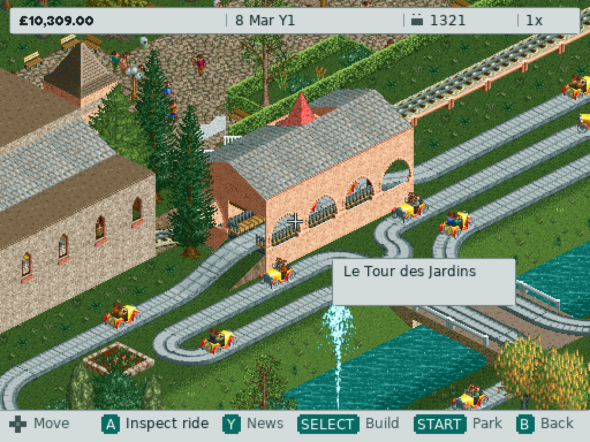
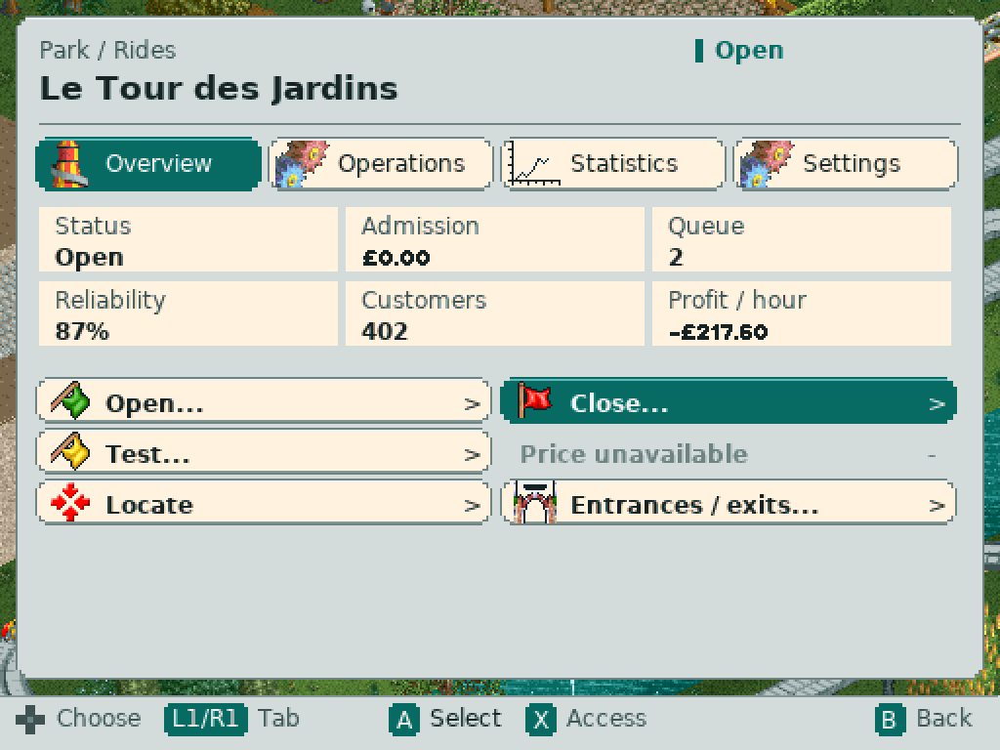
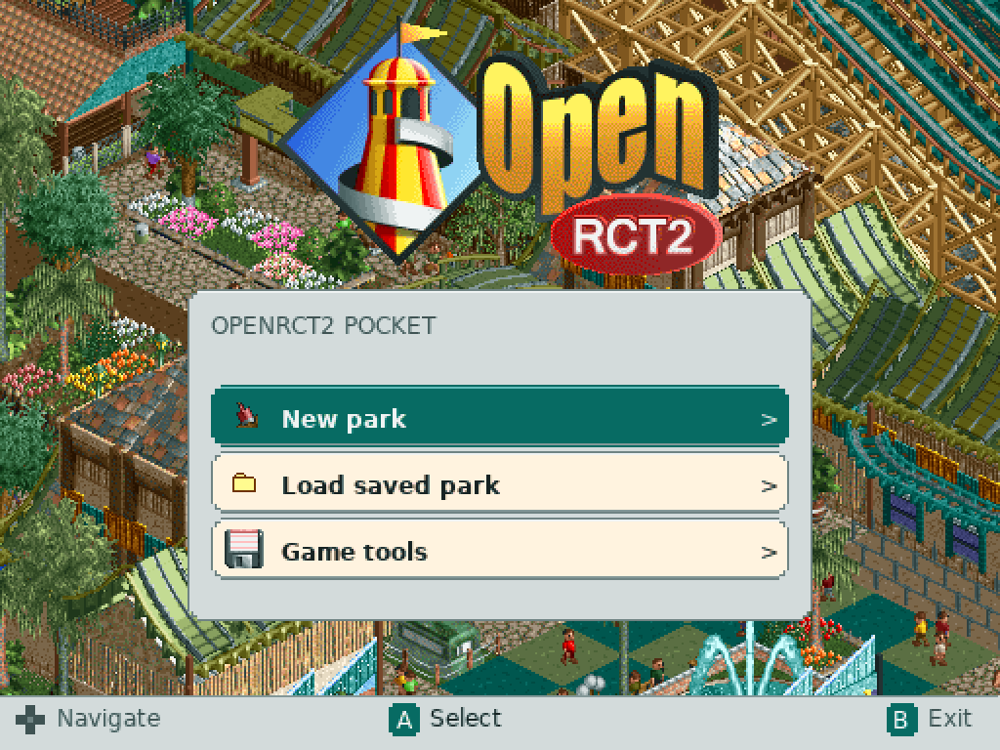
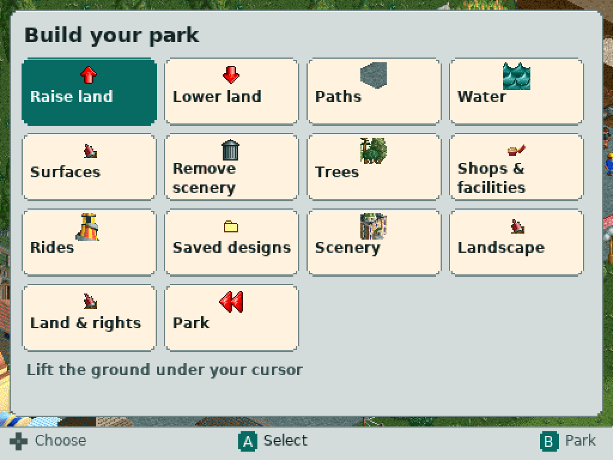
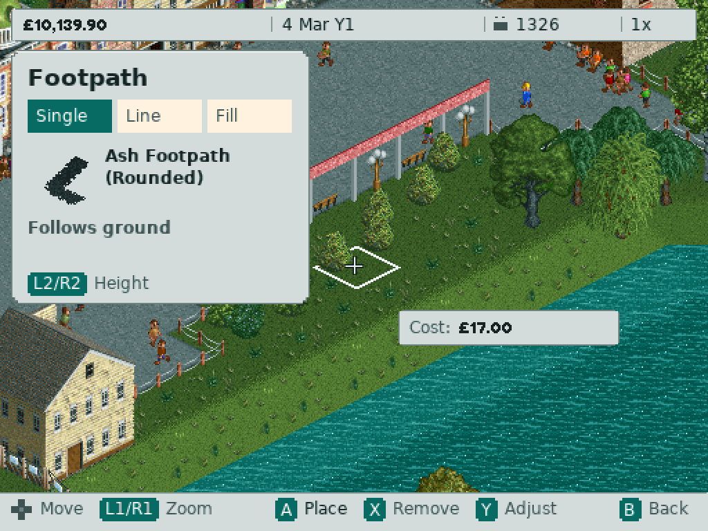

<h1 align="center">OpenRCT2 Pocket</h1>

<b>RollerCoaster Tycoon 2, rebuilt to play like a handheld game.</b> 
A controller-first fork of <a href="https://github.com/OpenRCT2/OpenRCT2">OpenRCT2</a> for the TrimUI Brick running NextUI.

  
  

Most ways of playing RCT2 on a handheld map the stick to a mouse and leave you squinting at desktop windows. Pocket takes a different approach: the camera moves and the cursor stays in the middle of the screen, every screen has a button footer, and management happens in sheets you page through with the shoulder buttons. It's meant to feel like a GBA-era sim that happens to run RCT2's simulation underneath.

The park renderer, simulation, game actions and save format are OpenRCT2's own, so parks behave exactly as they do on PC. Pocket changes only presentation and input, and only when `OPENRCT2_HANDHELD=1` is set; without it this is ordinary desktop OpenRCT2.

> **Status: beta.** It's playable on a real Brick, but expect rough edges. Back up your saves.

## What's different

- **Fixed centre cursor.** The D-pad moves the park, not a pointer. The footer tells you what A will do (*Inspect ride*, *Inspect guest*...) and a chip names what's under the cursor.
- **Pocket screens instead of desktop windows.** Guests, rides, staff, finances, research and marketing open as full-screen sheets with L1/R1 tabs and remembered focus.
- **Building made for a D-pad.** Paths with Single, Line and Fill modes and live cost, plus terrain, water, scenery, trees, shops, flat rides, mazes and custom coasters.
- **Handheld session basics.** Save slots, Save and quit, direct speed choices (Paused, 1x, 2x, 4x), and a quit shortcut that always offers to save.
- **Built for the screen.** A 512×384 logical canvas at 2× on the Brick's 1024×768 display, with its own Pocket Sans type.

  
  
  

## Controls

| In the park | |
|---|---|
| D-pad | Move the camera (the cursor stays centred) |
| A | Inspect what's under the cursor |
| B | Back / close |
| X | Rotate the view |
| Y | Park news |
| L1 / R1 | Zoom out / in |
| Select | Build menu |
| Start | Park dashboard (press again for the pause menu) |
| Start + Select | Quit, with a Save and quit prompt |

| In build tools | | In sheets and menus | |
|---|---|---|---|
| A | Place | D-pad | Choose |
| X | Remove | A | Select |
| Y | Adjust (turn, height, mode) | L1 / R1 | Change tab |
| L2 / R2 | Height | X | Contextual action, when shown |
| B | Back | B | Back |

The pause menu's **Controls...** page lists the shortcuts in-game.

## Install on a TrimUI Brick (NextUI)

You need your own copy of RollerCoaster Tycoon 2 (it's sold on Steam and GOG). **No game data is included here, and none should ever be added to this repository.**

1. Get the Pak: build it with [the NextUI packaging guide](packaging/handheld/nextui/BUILD.md) (a downloadable release will be linked here).
2. Extract it to the SD card root so that `Tools/tg5040/OpenRCT2 Pocket.pak/launch.sh` exists.
3. Copy the `Data`, `ObjData` and `Scenarios` folders from your RCT2 install into `Tools/tg5040/OpenRCT2 Pocket.pak/RCT2/`. `RCT2/Data/g1.dat` must exist.
4. Eject the card and launch **OpenRCT2 Pocket** from NextUI's **Tools** menu.

Saves and settings live in `.userdata/tg5040/openrct2-pocket/` and survive updates. See [INSTALL.md](packaging/handheld/nextui/INSTALL.md) for updating, logs and troubleshooting.

## Building and testing

- **Brick (AArch64) Pak:** [packaging/handheld/nextui/BUILD.md](packaging/handheld/nextui/BUILD.md)
- **Native Linux build and tests:** [docs/handheld/BUILDING.md](docs/handheld/BUILDING.md). Run with `OPENRCT2_HANDHELD=1` to get the handheld UI on a desktop.
- **Standalone tests:** `cmake -S test/handheld -B build-input-tests -G Ninja && cmake --build build-input-tests && ctest --test-dir build-input-tests`
- **In-game test drivers** (need your RCT2 data): `scripts/handheld/verify-ui-redesign.py --driver <name> ...`

The handheld layer lives in [`src/openrct2-ui/handheld/`](src/openrct2-ui/handheld) with small hooks into upstream code, which keeps merging upstream releases manageable. Design notes and verification records are in [`docs/handheld/`](docs/handheld).

## Known issues

- The scenario picker still uses desktop window chrome (title bar, tabs, close button) around Pocket-styled rows.
- When an action fails, OpenRCT2's red desktop error box appears and hides the Pocket HUD and footer for a few seconds.
- Some build-menu icons are mismatched in size or reused across tiles.
- Large, late-game parks haven't been performance-tested on the Brick's CPU.
- Changes since the last device-tested release are verified with native builds and test drivers only until they're checked on hardware.

## Licence and credits

OpenRCT2 Pocket is a fork of [OpenRCT2](https://github.com/OpenRCT2/OpenRCT2) and, like it, is licensed under the GNU General Public License v3 or later; see [licence.txt](licence.txt). Full credit to the OpenRCT2 developers and contributors ([contributors.md](contributors.md)), whose work makes this possible. The upstream README is kept at [docs/handheld/history/UPSTREAM-README.md](docs/handheld/history/UPSTREAM-README.md).

This is an unofficial fan project. It isn't affiliated with or endorsed by the OpenRCT2 team or Atari. RollerCoaster Tycoon is a trademark of its respective owner. Pocket Sans is a raster derivative of DejaVu Sans, distributed under the DejaVu font licence ([PocketSans.LICENSE](src/openrct2-ui/handheld/PocketSans.LICENSE)).
